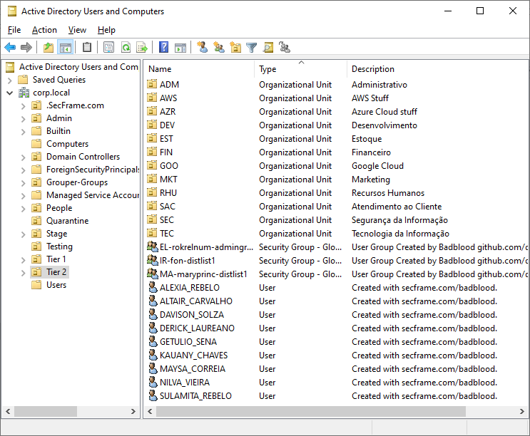

Adaptações para o [BadBlood](https://github.com/davidprowe/BadBlood) criar ambientes de Active Directory com nomes e sobrenomes brasileiros e OUs em português.




## 📁 Arquivos de nomes

Substituir os arquivos correspondentes no diretório `AD_Users_Create/Names` do BadBlood original.

| Arquivo | Conteúdo |
|---|---|
| `malenames-usa-top1000.txt` | Nomes masculinos brasileiros |
| `femalenames-usa-top1000.txt` | Nomes femininos brasileiros |
| `familynames-usa-top1000.txt` | Sobrenomes brasileiros |

## 📁 Arquivo de OUs

Substituir o arquivo correspondente no diretório `AD_OU_CreateStructure` do BadBlood original.

| Arquivo | Conteúdo |
|---|---|
| `3lettercodes.csv` | Setores organizacionais em português |

# 🔧 Correção no script para criação dos computadores

No arquivo `Invoke-BadBlood.ps1`, localize a seção `Computer Creation Time`.

Substitua:

```powershell
createcomputer -Domain $Domain -OUList $ousAll -ScriptDir $createuserscriptpath
```

Por:

```powershell
createcomputer -Domain $Domain -OUList $ousAll -UserList $AllUsers -ScriptDir $createuserscriptpath
```


## 📚 Créditos e referências

- **BadBlood original:** [David Rowe – GitHub](https://github.com/davidprowe/BadBlood)
- **Dados de nomes e sobrenomes:** [IBGE – Censo Demográfico 2022](https://censo2022.ibge.gov.br/nomes/rankings)
